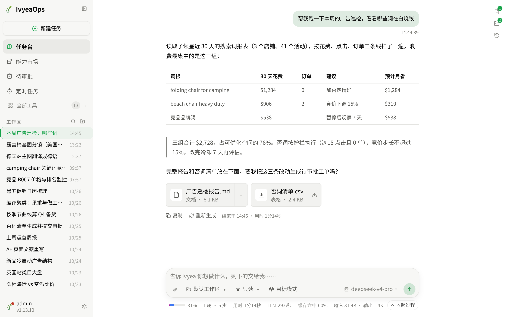
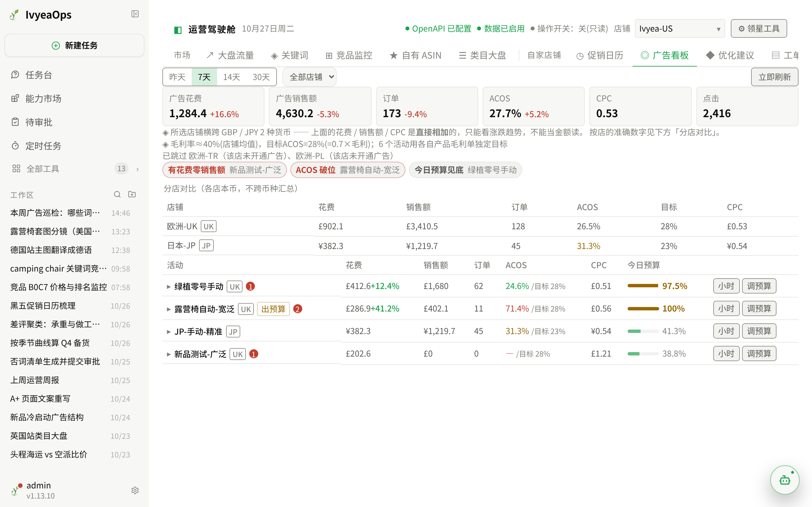
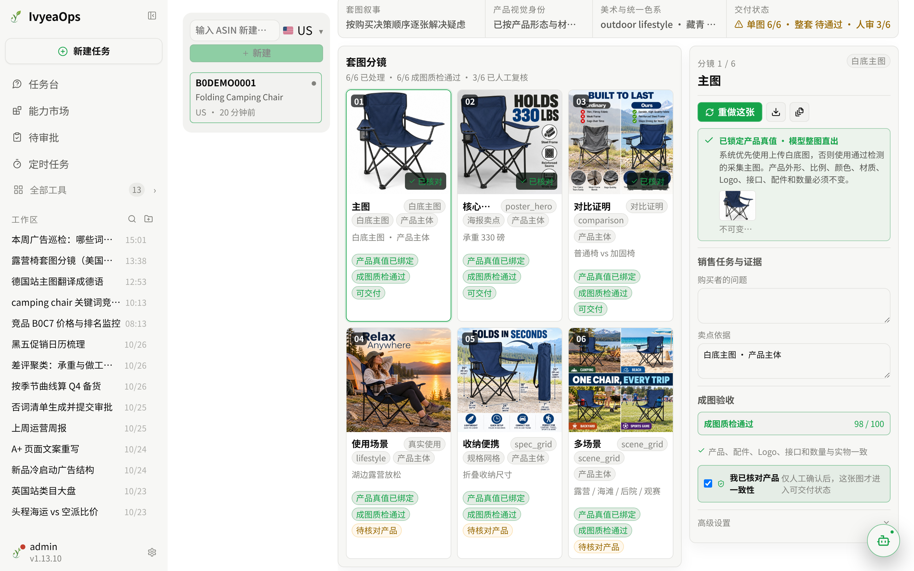
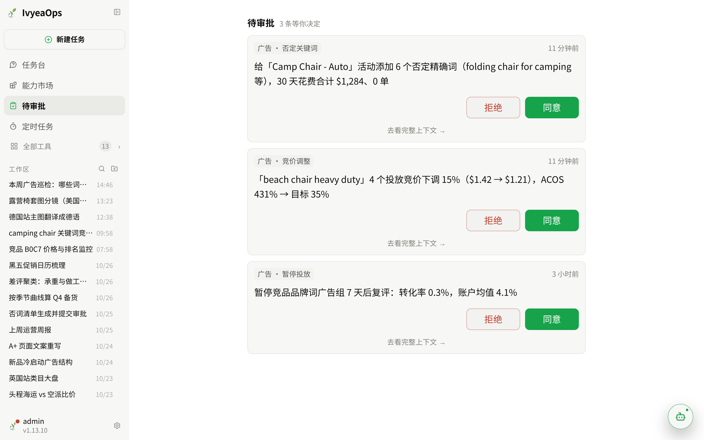
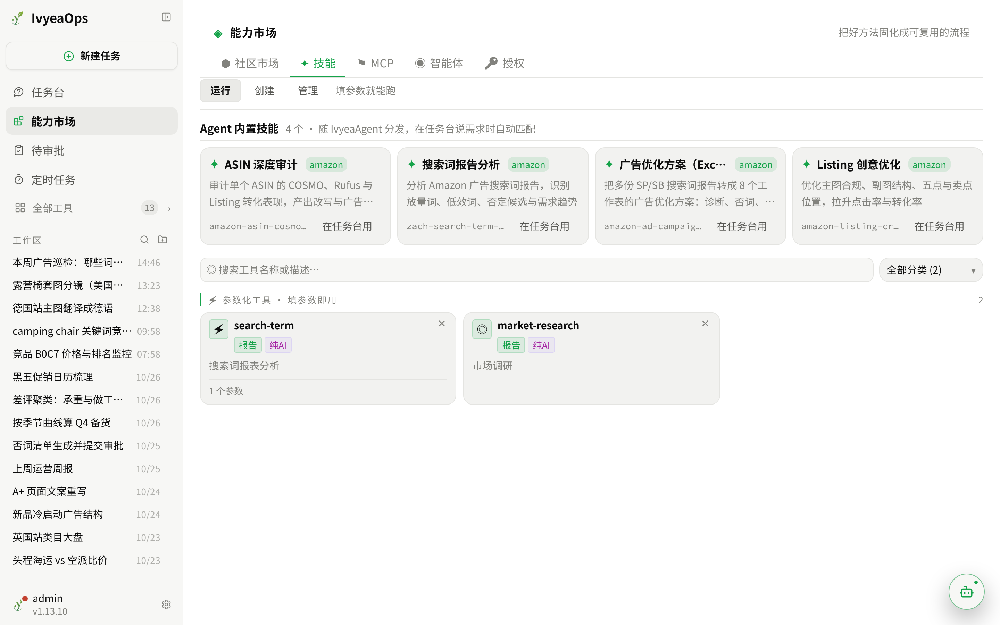
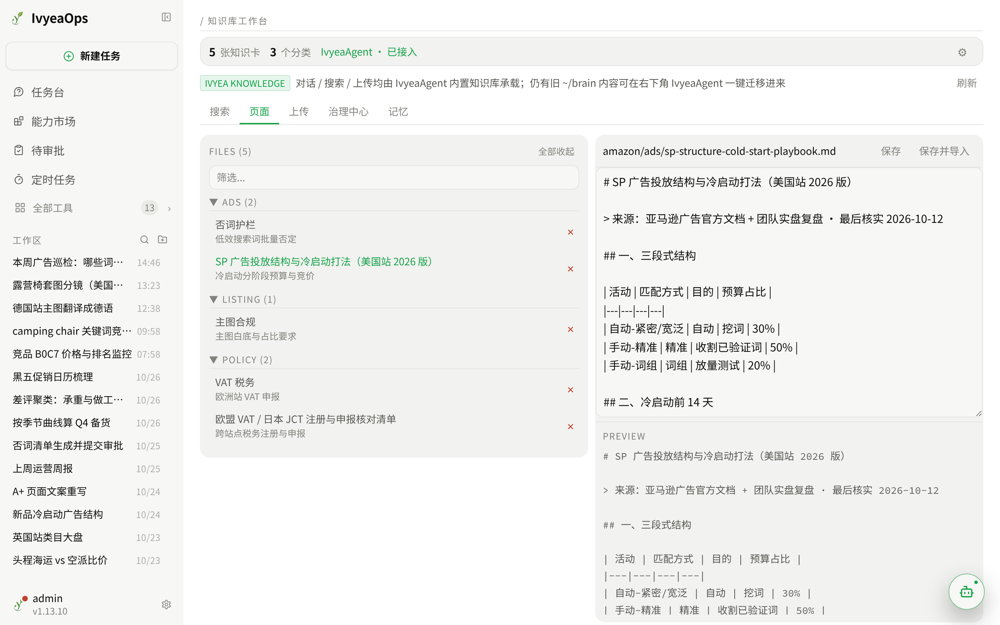

# IvyeaOps · 自托管亚马逊运营工作台

[](LICENSE)
[](https://github.com/Hector-xue/IvyeaOps/releases/latest)
[](https://github.com/Hector-xue/IvyeaOps/stargazers)


**开源、自托管的亚马逊运营工作台。** 广告巡检与优化、Listing 整套主图、市场调研、知识库，
用一句话交给 AI 去做；动真实店铺的每一步都要你点头。数据和密钥只留在你自己的机器上。

<p align="center">
  
  <br />
  <sub>任务台：一句话跑完广告巡检，直接给出浪费在哪、该怎么改、能省多少，报告和否词清单可下载</sub>
</p>

- **广告**：经领星官方 OpenAPI 接入，多店铺广告看板、优化引擎、搜索词巡检；改竞价、加否词先进待审批，人工确认才执行。
- **Listing**：一张白底图锁定产品真值，整套主图 / A+ 一次直出，逐张质检、人工复核后交付；一键翻译成多站点语言。
- **数据私有**：装在自己的电脑或服务器上，不经过任何第三方 SaaS。
- **开箱即用**：Windows / macOS 有免环境安装包，双击就能用。

---

## 界面预览

<table>
  <tr>
    <td align="center" width="50%">
      
      <br />
      <sub><strong>运营驾驶舱</strong>：多店铺广告花费、ACOS 与目标对比，异常活动一眼可见</sub>
    </td>
    <td align="center" width="50%">
      
      <br />
      <sub><strong>Listing 工作台</strong>：整套主图逐张质检、人工核对后交付</sub>
    </td>
  </tr>
  <tr>
    <td align="center" width="50%">
      
      <br />
      <sub><strong>待审批</strong>：AI 要动真实数据时停下来问你，同意了才执行</sub>
    </td>
    <td align="center" width="50%">
      
      <br />
      <sub><strong>能力市场</strong>：把好用的方法固化成技能，在任务台一句话调用</sub>
    </td>
  </tr>
  <tr>
    <td align="center" colspan="2">
      
      <br />
      <sub><strong>知识库工作台</strong>：团队打法、政策、税务资料集中管理，AI 回答时引用</sub>
    </td>
  </tr>
</table>

> 截图使用演示数据，不含任何真实店铺信息。

---

## 功能一览

| 板块 | 能做什么 |
|---|---|
| **任务台** | 用一句话交代任务：广告巡检、竞品分析、出图、写周报……AI 自己调工具做完，产物可下载 |
| **待审批 / 定时任务** | 写操作先停下来等你确认；让 AI 按时自己跑一轮（如每周一巡检广告） |
| **能力市场** | 技能、MCP 数据源、外部智能体统一管理；一句话生成新技能 |
| **运营驾驶舱** | 大盘流量、关键词、竞品监控、自有 ASIN、类目大盘、促销日历、广告看板、优化建议 |
| **Listing 工作台** | 采集 → 文案（标题 / 五点 / 描述）→ 整套主图与 A+ → 交付 |
| **一键图片翻译** | 一套图批量翻译成多站点语言，产品、版式、配色不变 |
| **市场调研 / 打法推荐 / 分析工具** | 关键词与类目洞察、品类打法、ASIN 深度审计、搜索词诊断、评论聚类 |
| **知识库工作台** | 上传、编辑、检索；治理中心做变更审核、时效看板、冲突检查 |
| **头程比价 / 资讯** | 头程运费比价；多信源每日行业资讯摘要 |
| **服务器终端 / 监控、外部智能体** | 给技术同事用：浏览器终端、资源监控、接入 Claude Code / Codex 等 CLI |

每个板块的用法见 [`docs/USAGE.md`](docs/USAGE.md)。

---

## 快速开始

**Windows**：到 [Releases](https://github.com/Hector-xue/IvyeaOps/releases/latest) 下载
`IvyeaOps-Windows-x64.zip`，解压后双击 **`IvyeaOpsServer.exe`**，不用装 Python / Node。

**macOS**：下载 `IvyeaOps-macOS.zip`，解压后双击 **`IvyeaOps.app`**。首次被拦截时右键 →「打开」一次即可。

**Linux**：

```bash
curl -L https://github.com/Hector-xue/IvyeaOps/releases/latest/download/IvyeaOps.zip -o IvyeaOps.zip
unzip IvyeaOps.zip && cd IvyeaOps
bash scripts/install.sh && bash scripts/start.sh
```

浏览器打开 **http://127.0.0.1:8001**，首启向导会带你配好模型和密钥。

> 国内网络把下载地址换成 `https://ghfast.top/https://github.com/...` 即可，安装脚本会自动切到国内镜像。
> 服务器部署（nginx / HTTPS / systemd）、局域网共享、从源码构建见 [`docs/INSTALL.md`](docs/INSTALL.md)；
> 装不上先看 [`docs/TROUBLESHOOTING.md`](docs/TROUBLESHOOTING.md)。

---

## 团队使用

- **多用户**：同事自助注册，管理员审批后启用。
- **按板块授权**：Listing、图片翻译、分析工具、知识库、终端等可逐项授予；内置运营专员、运营主管、设计、技术助理、客服五种岗位预设。
- **审计流水**：谁在哪个板块做了什么都有记录，凭据自动脱敏。
- **写操作护栏**：领星写操作默认关闭；开启后受店铺白名单、单次改动幅度上限、多模型复核与人工确认约束。

配置项、模型接入、领星对接、备份与升级见 [`docs/CONFIG.md`](docs/CONFIG.md)、
[`docs/lingxing-erp-guide.md`](docs/lingxing-erp-guide.md)、[`docs/OPERATIONS.md`](docs/OPERATIONS.md)。

---

## 二次开发

后端 FastAPI（Python），前端 React + Vite（TypeScript），后端直接托管前端构建产物。
前后端按板块拆分，路由、服务、页面一一对应，新增一个板块就是加一组这三样再挂到导航上。
目录结构与开发约定见 [`AGENTS.md`](AGENTS.md) 和 [`CONTRIBUTING.md`](CONTRIBUTING.md)。

---

## 商业合作

需要以下服务，可以联系作者：

- **私有化部署**：装到你公司的服务器或电脑上，接通领星，配好团队账号和权限
- **定制开发**：对接你们自己的 ERP 和数据源，定制报表、流程和板块
- **二次开发支持**：你们自己的技术团队改代码时，提供架构讲解和问题排查

联系方式：关注下方公众号，留言「商业合作」，写明需求和现有环境。

---

## 交流与反馈

<table>
  <tr>
    <td align="center" width="50%">
      
      <br />
      <strong>微信群：Ivyea 的精神股东们</strong>
      <br />
      <sub>用户互助、交流运营经验、提改进建议</sub>
    </td>
    <td align="center" width="50%">
      
      <br />
      <strong>公众号</strong>
      <br />
      <sub>群二维码失效时，关注后获取最新版</sub>
    </td>
  </tr>
</table>

**提问和报 Bug**：先查 [`docs/TROUBLESHOOTING.md`](docs/TROUBLESHOOTING.md) 和已有
[Issue](https://github.com/Hector-xue/IvyeaOps/issues)；还没解决就提 Issue，附上**诊断包**（系统配置页一键导出，不含密钥和店铺数据）、复现步骤和版本号。
这是个人维护的项目，Issue 会在有精力时处理，不承诺响应时间；需要一对一远程协助请走上面的商业合作。

---

## 安全须知

- `server/.env`、`data/` 已加入 gitignore，**切勿提交**；备份时别漏 `data/.master.key`（配置里的密钥靠它解密）。
- 管理员账号约等于机器权限（内置终端可访问全盘），请谨慎分配。
- 威胁模型和漏洞报告方式见 [SECURITY.md](SECURITY.md)。

---

## 致谢

- CloudCLI UI (https://github.com/siteboon/claudecodeui) —— 「外部智能体」板块移植自该项目（AGPL-3.0）。本项目对其做了修改，并非 CloudCLI UI 原版。
- [Hermes Agent](https://github.com/NousResearch/hermes-agent)（NousResearch）—— 可选的外部智能体，作为独立程序调用，未内置其源码。
- FastAPI · React · Vite · xterm.js 等开源项目。

## 许可证

[AGPL-3.0](LICENSE)。可自由使用、修改、自托管；若修改后作为网络服务提供给他人使用，须向这些用户提供对应源码（第 13 条）。
版本变更见 [CHANGELOG.md](CHANGELOG.md)。

---

## ☕ 请作者喝杯咖啡

觉得好用的话，点个 Star 就是很大的支持；也欢迎请作者喝杯咖啡。

<p align="center">
  
</p>
